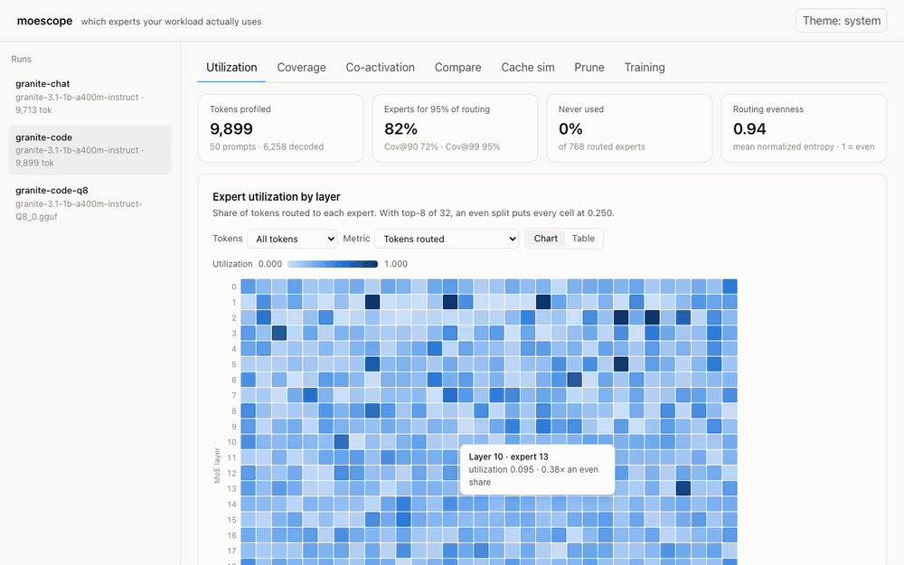

# moescope

See which experts **your** workload actually uses inside an open Mixture-of-Experts model, and turn that into cache-size, offload, and pruning decisions.

moescope records every router decision (top-k expert ids and weights, per layer, per token) while a model runs on your prompts. It then shows utilization, skew, and co-activation, simulates expert caches at different memory budgets, and masks the experts you never use to measure what that costs in quality. Everything runs locally.



## What it found on a real run

Profiling `ibm-granite/granite-3.1-1b-a400m-instruct` (24 MoE layers × 32 experts, top-8) on 50 coding prompts and 50 chat prompts, about 10k tokens each:

- **Five experts act as shared experts even though the model doesn't declare any.** Layer 1 experts 8, 13 and 19, plus layer 2 experts 24 and 26, are chosen for 100% of tokens. That held for code, for chat, and under llama.cpp with Q8_0 weights. Pin these five first.
- **Code prompts used 82% of experts at Coverage@95** (72% at Coverage@90). Granite routes fairly evenly (mean normalized entropy 0.94), so there is little dead weight to drop.
- **Code and chat use measurably different experts.** The mean Jensen-Shannon distance between the two workloads is 0.16, against a noise floor of 0.03–0.04 between random halves of the same workload. The gap is largest in layers 7–9.
- **LRU caching thrashes below one full sweep.** Each token touches 24 × 8 = 192 experts in a fixed cycle, so a 170-slot LRU cache hits 0%. Pinning the hottest experts in the same space hits 42%.
- **Coverage@99 masks 5.5% of experts with no measurable quality loss** on a 20-item exact-match eval. Coverage@80 (42% masked) breaks the model completely.
- **Quantization barely moves the router.** On identical input tokens, the Q8_0 GGUF under llama.cpp picks the same top-1 expert as the bf16 Hugging Face model 96.7% of the time.

## Quickstart (2 minutes)

```bash
# Install from source (a PyPI release is planned)
git clone https://github.com/kjoshiDTX/moescope && cd moescope
uv venv && uv pip install -e . && source .venv/bin/activate

# 1. Record router decisions on your prompts (downloads the 2.7 GB model once)
moescope profile --model ibm-granite/granite-3.1-1b-a400m-instruct \
  --prompts examples/code.jsonl --max-new-tokens 128 --out runs/granite-code

# 2. Per-layer utilization, entropy, Coverage@90/95/99, hottest/coldest experts
moescope analyze runs/granite-code

# 3. Expert-cache hit rates at several budgets, plus engine settings
moescope simulate runs/granite-code --budget-gb 0.5,1,1.5,2

# 4. Look at it
moescope ui
```

Prompt files are JSONL, one object per line: `{"id": 0, "category": "code", "prompt": "..."}`. `category` is optional. `examples/` has code, chat, RAG, and mixed sets, plus a small eval set.

## Commands

| Command | What it does |
| --- | --- |
| `moescope profile` | Runs prefill and greedy decode on each prompt, recording the top-k experts and weights for every token in every MoE layer. Before tracing, it checks its hooks against the model's own router logits. |
| `moescope analyze RUN [--compare RUN2]` | Prints utilization, entropy, Coverage@p, and hot/cold experts, and writes `report.json`. `--compare` shows which experts gain or lose share between two workloads, plus top-1 agreement when both runs saw the same tokens. |
| `moescope simulate RUN --budget-gb ... --policy lru,lfu,pinned` | Replays the trace through each cache policy and reports hit rate and bytes moved per token. It recommends a budget and prints llama.cpp flags, but only flags your installed `llama-server --help` actually lists. |
| `moescope prune RUN --eval EVAL --keep-coverage 90,95,99` | Masks every expert outside each coverage set (router logits set to −∞), reruns your eval, and reports quality vs. masked share. |
| `moescope train-watch LOGDIR` | Summarizes a fine-tuning log written by `MoEWatchCallback`. |
| `moescope ui [RUNS_DIR]` | Opens the read-only dashboard on `127.0.0.1:7878`. It works fully offline. |

### Watching fine-tuning

```python
from moescope.train import MoEWatchCallback

trainer = Trainer(..., callbacks=[MoEWatchCallback(log_dir="runs/ft")])
```

Every `log_every` steps (default 10), the callback logs aux loss, z-loss, mean max router logit, and each expert's token share per layer. It warns when one expert in any layer holds more than 3× its fair share for 200 steps (router collapse). Both thresholds are configurable.

## Supported models

| Backend | Models | Notes |
| --- | --- | --- |
| `hf` (default) | Granite MoE, Qwen2-MoE, Qwen3-MoE, OLMoE, Mixtral | Needs transformers 5.x. Tested end to end on Granite 3.1 1B-A400M (MPS). The other families are tested on tiny random-init models of each architecture. |
| `llamacpp` | Any GGUF MoE model llama.cpp runs | `--backend llamacpp --model path/to/model.gguf`. Needs llama.cpp installed (`brew install llama.cpp`). A small C++ tracer is compiled against it on first use. About 10× faster than `hf` on Apple Silicon. |

Pass `--tokenizer <hf-model-id>` with the llamacpp backend so prompts are tokenized exactly as the HF run did; then `analyze --compare` reports like-for-like top-1 agreement.

One llama.cpp difference: during prefill it evaluates the last layer only for the final prompt token, so its traces have fewer last-layer rows. That matches what the engine loads, so cache simulations stay faithful.

## Definitions

- **Utilization** of expert *e* in layer *l*: tokens routed to *e* ÷ tokens in *l*. A layer's values sum to top-k.
- **Routing entropy**: Shannon entropy of a layer's share distribution. Normalized entropy is 1.0 when routing is perfectly even.
- **Coverage@p**: the smallest number of experts per layer that together receive p% of routed tokens.
- **Co-activation**: how often experts *i* and *j* are both in a token's top-k. The dashboard also shows lift: observed pair rate ÷ the rate if experts were picked independently.
- **Cache hit rate**: the share of expert lookups already resident. Lookups replay in token order, and shared experts are always resident.

## Trace format

A run is a directory holding `run.json` (model, expert count, top-k, expert size, settings) and `routes.parquet`, with one row per token per MoE layer:

`prompt_id` int32 · `category` string · `phase` prefill/decode · `token_pos` int32 · `layer` int16 · `expert_ids` list[int16] · `weights` list[float16] · `logit_max` float16

Every backend writes exactly this schema (`moescope/trace/schema.py`), so analysis never needs to know which engine produced a trace. 10k tokens on a 24-layer model takes about 4.4 MB.

## Limitations

- Pruning masks experts in the router; it does not remove weights. Reported savings are what a smaller checkpoint *would* free. Exporting a smaller checkpoint is planned.
- The cache simulator models reactive policies only, with no prefetching of next-layer experts.
- Only the `hf` backend can prune, since masking hooks into the PyTorch router.
- Models whose routed index space includes shared experts (DeepSeek-style) are not supported yet by either backend.

## Development

```bash
uv venv && uv pip install -e . && uv pip install pytest playwright && playwright install chromium
pytest                       # unit, golden-trace, simulator, tiny-model, and dashboard tests; no downloads
pytest -m slow               # real-model smoke tests (Granite 1B; the llama.cpp test also needs a GGUF)
cd web && npm install && npm run build   # rebuilds the dashboard into moescope/server/static
```

Analysis and simulation code never imports torch. The tests check that.
